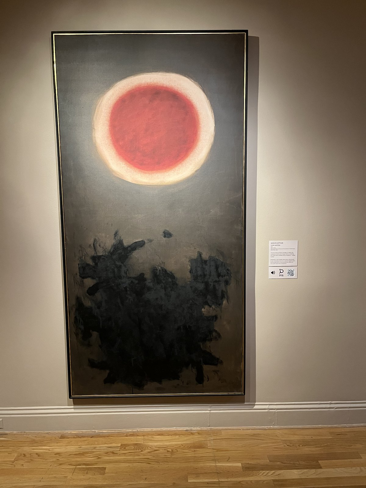
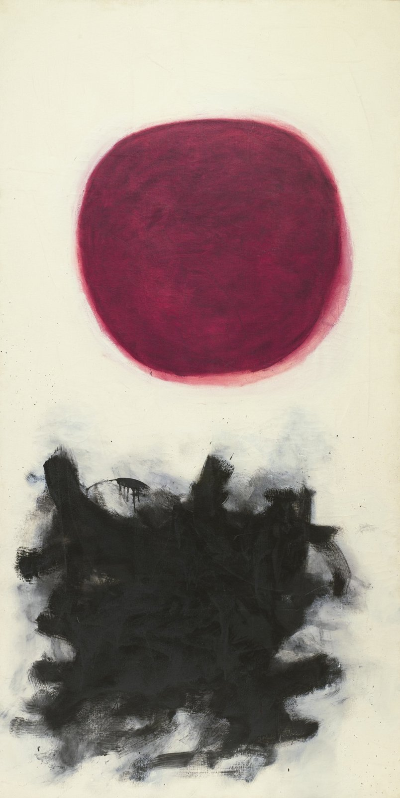
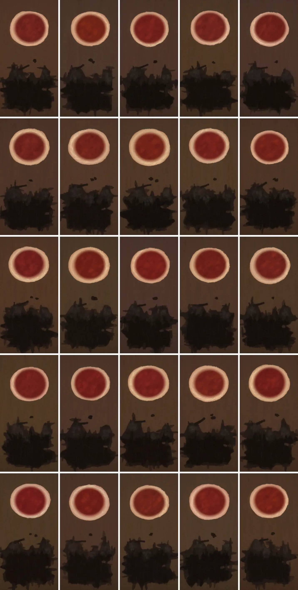

Here's an interactive visualization of Adolph Gottlieb's painting _Under and Over_ (1959).



I saw the "Avery, Gottlieb & Rothko: By the Sea" exhibition at the [Phillips Collection](https://www.phillipscollection.org/) over the Thanksgiving break. I wasn't previously familiar with [Adolph Gottlieb](https://en.wikipedia.org/wiki/Adolph_Gottlieb), who took summers together with fellow artists Mark Rothko and Milton Avery. I was most struck by _Under and Over_ (1959) – although Avery's _Lone Rock and Surf_ (1945) was also excellent.

_Adolph Gottlieb, Under and Over (1959). Photographed in the Phillips Collection by Zachary Levonian. Artwork copyright: Adolph and Esther Gottlieb Foundation._

I created the visualization above – with the help of Claude Opus 5.5 – to explore the visuals of _Under and Over_. 
Here's the description of the piece in the [museum guide](https://guides.bloombergconnects.org/en-US/guide/phillipsCollection/item/e1a4435e-2c41-45e5-ab60-f32d47903e16):

>In front of you now is the work _Under and Over_ painted by Adolph Gottlieb in 1959. It's a prime example of what he called his Burst paintings. Throughout his career, Gottlieb had built his work around the idea of conflict, a dynamic balance of competing urges and impulses. Evolving out of his Imaginary Landscape series, the Burst paintings are his most pared down expression of that idea. Here's Sanford Hirsch, executive director of the Adolph and Esther Gottlieb Foundation.
>>The Burst paintings come directly from the Imaginary Landscapes, but they're a vertical rather than a horizontal format. When he starts the Burst paintings, they begin in 1956, and he kind of refines the image into early 1957. Once he finds it, he becomes fascinated with it, and for the next 2 and 1/2 years, he paints almost nothing but Burst paintings. Gottlieb at one point describes the way he approaches his art and says it's like being poor. I'm always taking things out of my paintings. So the Burst were a more radical shift. It's another leap that he took, and in this case in 1956 and 57, to radically simplify the imagery, but doing that so that he could intensify the emotional response to the images he was using. People often think of the Burst painting as a disc above a splash image, and that's true, but there are dozens if not hundreds of variations of that. He's always exploring. He's always trying to find what more he can do using as few means as possible to get the emotional result that he wants.

The painting isn't discussed much online, but it's similar to the better-known _[Blast I](https://www.moma.org/collection/works/78373)_ (1957), one of a trio of paintings that kicked off Gottlieb's Burst series. 

_Adolph Gottlieb, Blast I (1957), Museum of Modern Art. Copyright: Adolph and Esther Gottlieb Foundation._

Art historian Pepe Karmel describes the Burst series as "representations of archetypal landscapes", and says that the general format "serves as the template for the majority of Gottlieb’s work from 1957 until his death in 1974" (["Adolph Gottlieb: Artist and Cosmos"](https://www.academia.edu/9989409/Adolph_Gottlieb_Artist_and_Cosmos), 2012).

Karmel assembled a number of perspectives on _Blast I_ that seem to apply nicely to _Under and Over_ as well.
* Here's Gottlieb himself: "I try, through colors, forms and lines, to express intimate emotions… My paintings can represent an atomic
bomb, a sun, or something else altogether: depending on the thinking of whoever is looking at it."
* Finley Eversole: "The composite image of _Blast I_ is one of the sun rising over the smoking, twisted debris of some inwardly destroyed
Hiroshima. Here is violence and chaos, yet over the ‘night’ a marvelous sun has risen…" "Gottlieb’s dialectical art is an art of _regeneration_, of perpetual descent and return."
* Hubert Crehan: "Gottlieb’s shapes seem to be personal coefficients of the Yin and Yang symbols—the ovoid vessel and the spermatozoic
flagella—in a surrounding void."
* Pepe Karmel: "The lower burst could be seen as evoking land or sea, while the upper burst represented the sun."
* Emily Genauer: The Burst paintings "have to do with wonder over the vastness and majesty of the universe."

_Twenty-five generated perspectives on Under and Over._

You can explore the imagery of _Under and Over_ using the interactive tool below. I love how much the emotion of the piece changes as you increase the size of the red sun, or let the dark mass control more of the painting.



Notes from Claude on how the visualization works

<em>Written by Claude (Opus 5.5, November 2026)</em>

<strong>What it is.</strong> No photographs or image models are used to draw it, and nothing is copied from an image. Every interactive painting on this page is drawn from scratch, in your browser, by about 650 lines of JavaScript drawing on an HTML canvas. (The grid of 25 is a saved image of the same generator's output, to spare your browser the work.) A number (the seed) drives a random number generator, and the same seed always gives the same painting. That is why the seed under the painting works as a link. Drawing one full-size painting takes about a tenth of a second on a laptop (several times that on a phone), so the widget keeps a few ready ahead of time.

<strong>How it was matched.</strong> I don't see paintings the way a person standing in the Phillips does. What I could do was put a render next to a scan of the painting and compare numbers: the average color of the ground, the halo, the red and the dark mass, region by region. The numbers caught things my reading of the images missed. One early version had a faint green cast in the dark mass that looked fine but measured wrong. The sources also disagree with each other. Web scans are flatter and browner. Zach's gallery photo, and Zach's memory of the room, show a gray-olive ground, a halo that is almost luminous, and a coral red. We kept the scan's colors as the base and moved the in-person range into individual brushstrokes: buttery highlights in the halo, passages of vermilion in the red, and cool gray zones in the dark mass.

<strong>The layers, bottom to top:</strong>

<ul>
<li><strong>Ground:</strong> a warm brown, darkening toward the foot, worked over with dry vertical strokes. About a third of the strokes are a cooler gray-olive.</li>
<li><strong>Halo:</strong> a soft cream band, brightest on one side. Zach pointed out that in the painting the halo seems to peek out from <em>behind</em> the ground, rather than the reverse. So the last thing drawn at its outer edge is dozens of short ground-colored strokes that bite into the cream.</li>
<li><strong>Sun:</strong> a red disc, nearly centered in the halo, with a feathered edge. It is mottled and scumbled with darker and brighter reds.</li>
<li><strong>Dark mass:</strong> its outline is built from separate wavy curves for the top (towers, usually two big ones with smaller spikes, and a dip between), the bottom (legs), and the sides (fingers and notches). Its edges are soft, ragged ribbons. We tried bristly strokes first; they looked like fur, then like cross-hatching. Last come the details: the arm reaching up, the floating dab, scratches and drips.</li>
</ul>

<strong>What changes from seed to seed:</strong> small things, on purpose. The sun's size, height and offset. The halo's shape and warmth. Which side glows. The positions and heights of the towers. The arm, the fingers, the notches and the dab. The variants stay close to the original, and the parameter explorer is there for going further. Its red marks, labeled “closer to truth,” show the range the variants use, and the sliders go well beyond them.

<strong>The interactions</strong> are attempts to give a still image a little of what it has in a room. The flick is a slot machine of perspectives that all land somewhere nearby. Focus mode dives into the sun and comes back out at full size: where the browser allows full screen, the switch happens behind a close-up of the sun's red, brushed on and scraped off again. In focus mode, each new variant's ground ripples out as rings that settle when it lands.

<strong>What it can't do.</strong> It has no thickness of paint, no scale, and no light falling across a surface, and those are much of what makes the painting work in person. More basically, it imitates the <em>results</em> of Gottlieb's decisions, not the decisions. Every seed is a plausible arrangement of the same parts, and none of them is a new idea. Hirsch's line about Gottlieb (that "there are dozens if not hundreds of variations" of the Burst image) is part of why a generator felt like a fair way to look at this painting. But his variations were each a judgment, and these are draws.

## Further reading
* David Curcio, ["‘Avery, Gottlieb & Rothko: By the Sea’ Shows How Three Midcentury Greats Were Shaped by the Shore and One Another"](https://www.bostonartreview.com/read/avery-gottlieb-rothko-by-the-sea-cape-ann-museum-david-curcio), _Boston Art Review_, August 2026
* Judith H. Dobrzynski, ["‘Avery, Gottlieb & Rothko: By the Sea’ Review: Illuminating an Unlikely Kinship"](https://www.capeannmuseum.org/news/2026/08/03/the-wall-street-journal-avery-gottlieb-rothko-by-the-sea-review-illuminating-an-unlikely-kinship/), _Wall Street Journal_, August 2026
